<!-- _class: lead -->
<!-- _paginate: false -->

# Sandboxing Agentic AI

### Hands-on with Kubernetes + `kind` + the `agent-sandbox` CRD


omrishiv/agent-sandbox

<!--
Welcome. Today we go from "what is a container" to running an actual agent sandbox
on Kubernetes. The whole point: model-generated code is untrusted, and the box we
run it in is the only thing standing between that code and the rest of the cluster.
Everything here feeds directly into the lab you'll run on a kind cluster.

If you can take away one thing from today: AI has made it easier for attackers to exploit targets while not giving the same tools to defenders. Attackers will use abliterated models or jailbreak attempts to get offensive cyber capabilities to attack targets. Meanwhile, defenders can use models to scan code, but they will not go to as great a length to trick a model into defending code. The agents will persist in trying to attack: the goal, while attempting to adhere to guard rails against defense. The more we can defend in depth, the better. 

-->

---

## Agenda

1. Containers vs VMs
2. Why sharing the kernel is great and dangerous
3. Why agentic AI makes this a bigger issue
4. A threat model for agent sandboxes
5. Different levels of isolation: hardening → gVisor → microVM
6. Kubernetes
7. The `agent-sandbox` project & `Sandbox` CRD
8. Lab
9. Defense-in-depth & takeaways

<!--
-->

---

## What is a container?

A container is **a process** on the host

- **Namespaces** scope what it can *see*: `pid`, `net`, `mnt`, `user`, `uts`, `ipc`
- **cgroups** scope what it can *use*: CPU, memory, I/O, PIDs
- **Layered image** = the root filesystem, shipped as stacked layers

It shares the **HOST KERNEL**. There is no guest OS.

<!--
A container is a Linux process the kernel scopes down.
It still uses the same kernel as everything else on the node.
-->

---

## What is a VM?

A virtual machine runs a **full guest OS with its own kernel**:

- A **hypervisor** (KVM, QEMU, Firecracker) virtualizes the hardware
- Guest sees virtual CPU, memory, disks, NICs, not the host's kernel
- Boundary is enforced in **hardware** (VT-x/AMD-V), not just kernel code

```
┌──────────────┐
│  Guest OS    │  ← its own kernel
│  + app       │
├──────────────┤
│  Hypervisor  │  ← hardware-virtualized boundary
├──────────────┤
│  Host kernel │
└──────────────┘
```

<!--
VMS have stricter isolation than containers, but they are slower to start and are larger due to 
requiring a full operating system to back
-->

---

## Containers vs VMs

| Dimension           | Container                     | Virtual Machine                |
| ------------------- | ----------------------------- | ------------------------------ |
| Boot time           | **milliseconds**              | seconds                        |
| Image / footprint   | MBs                           | GBs                            |
| Density per host    | hundreds–thousands            | tens                           |
| Isolation boundary  | **syscall / shared kernel**   | **virtual hardware**           |
| Kernel              | shared with host              | own guest kernel               |


<!-- diagram source: diagrams/containers-vs-vms.mmd — regenerate with: npm run build:diagrams -->

<!--
Containers use the same shared kernel as the operating system, while VMs give each workload its own kernel over a hypervisor.
-->

---

## Stricter isolation increases cold start time

| Runtime | Boundary | ~Cold start |
| ------- | -------- | ----------- |
| `runc` container | shared kernel | ~tens of ms – 0.3s |
| gVisor (`runsc`) | userspace kernel | ~0.5s |
| Kata / Firecracker microVM | guest kernel | ~seconds |
| full traditional VM | guest OS boot | tens of s – minutes |

<!--

-->

---

### Kubernetes
Gartner predicts that by 2028, 95% of new AI deployments will be on Kubernetes

---

## What is Kubernetes?

**Orchestrator**: schedules and runs containers across machines.

- **Decides**: where containers run, when to restart and scale, and networks them
- **Glue**: service discovery, load balancing, rollouts,
  secrets/config, storage, RBAC, autoscaling, self-healing
- **State**: controllers continuously reconcile cluster to match state

Kubernetes is **where agent sandboxes get scheduled** and what we need to tune to harden them

<!--
Kubernetes runs containers on shared-kernel Linux nodes and it's the layer where we
configure isolation.
-->

---

## Benefits of sharing a kernel

- **Fast start:** milliseconds; there's no OS to boot
- **High density:** hundreds of containers per node
- **Tiny images:** ship an app without an OS
- **Reproducible environment:** `Dockerfile` declares an environment
- **Cheap to spin up & tear down** on demand

Spin up **thousands of per-task ephemeral sandboxes**, then throw them away.

<!--

-->

---

## Shared kernel = shared attack surface

**One kernel bug or one misconfig = escape.** traps:

- `privileged: true`
- `hostPath` mounts (especially `/`)
- `hostPID` / `hostNetwork`, **no seccomp** profile
- mounted **service-account token** with broad RBAC
- running as **root**, writable rootfs
- **no NetworkPolicy** (open egress)

VMs have a smaller, hardware-enforced boundary. Defense in depth, but cost more.

<!--
We will take a look at how to exploit all of these in the lab
-->

---

## Why agentic AI makes this problem worse

Agents run **model-generated, untrusted code**:

- Tool use + autonomy means the box executes whatever the model emits
- **Prompt injection** can make that code intentionally adversarial
- Platforms run a **high volume** of ephemeral sandboxes
- Often **multi-tenant**: many users' agents on shared infra

<!--
With agentic AI, we have a harder time scoping the impact of failure. Agents will continue to retry tasks. Due to being trained to succeed, these attempts will turn adversarial.
-->

---

## What are we protecting?

| Target                                | Attack if we don't                 |
| ------------------------------------- | ---------------------------------- |
| **node / host**                       | Container escape → own the node    |
| **control plane** + tenant secrets    | API / service-account token abuse  |
| **network** + metadata endpoints      | Cross-tenant / SSRF to metadata    |
| **Other sandboxes**                   | Resource exhaustion, lateral move  |

Assume the workload is adversarial and minimize what each sandbox can reach.

<!--
We need to defend against multiple targeted attacks
-->

---

## Isolation is a spectrum

<style scoped>section{font-size:26px} table{font-size:24px}</style>

| Tier | Mechanism | Boundary | Start | Strength |
| ---- | --------- | -------- | ----- | -------- |
| **0** | plain `runc`: namespaces + cgroups | shared kernel | ~ms | weakest |
| **0.5** | OS/K8s hardening (still shared kernel) | shared kernel, trimmed | ~ms | better |
| **1** | **gVisor** (`runsc`) userspace kernel | intercepts syscalls | ~0.5s | strong |
| **2** | **Kata / Firecracker** microVM | real guest kernel | ~seconds | strongest |

**Always:** drop capabilities, `runAsNonRoot`, `allowPrivilegeEscalation: false`, `readOnlyRootFilesystem`, seccomp `RuntimeDefault`, no token automount, least-privilege RBAC, NetworkPolicy (egress deny), resource limits.

<!--
Isolation adds latency. Hardening is free and mandatory. gVisor shrinks the kernel attack surface for ~half a second of
startup. microVMs give a real guest kernel for a few seconds. Pick the level per workload.
-->

---

## Picking a runtime: gVisor vs Kata vs Firecracker

<style scoped>section{font-size:26px} table{font-size:24px}</style>

| Runtime | How | Needs `/dev/kvm`? | Pros | Cons |
| ------- | --- | --- | ---- | ---- |
| **gVisor** (`runsc`) | userspace kernel intercepts syscalls | **No** (systrap) | big cut to host-kernel attack surface; low overhead, ~0.5s start | syscall/compat gaps; perf hit on syscall/I-O-heavy work; port-forward quirks |
| **Kata** (`kata-qemu`) | real guest kernel in QEMU VM per pod | **Yes** | hardware-virtualized isolation; OCI/K8s compatible | higher mem/CPU overhead; ~seconds start |
| **Firecracker** (microVM) | minimal VMM on Linux/KVM | **Yes** | ~125ms microVM boot; tiny footprint; high-density multi-tenant | Linux/KVM only; minimal device model; needs bare-metal/nested virt; requires orchestration |

<!--
gVisor is the easier lift for agent workloads (cheap, strong enough); Kata/Firecracker when you need a true guest kernel.
-->

---

## Which isolation when?

<style scoped>section{font-size:26px} table{font-size:24px}</style>

| Your workload | Use | Why |
| --- | --- | --- |
| Trusted first‑party, perf‑critical | **`runc` + hardening** | zero overhead |
| **Untrusted / model‑generated** agents | **gVisor** | kernel‑surface cut, ~0.5s, no KVM |
| Hostile / **multi‑tenant** / compliance | **Kata** | real guest kernel; syscall compat |
| **Serverless‑scale** ephemeral VMs | **Firecracker** | ~125ms microVM, high density |

<!--
-->

---

## Where Kubernetes plugs these in

- **`RuntimeClass`:** `gvisor` or `kata-qemu` sandbox
- **`securityContext`:** caps, non-root, no-priv-esc, read-only rootfs, seccomp
- **`NetworkPolicy`:** default-deny egress
- **RBAC + `automountServiceAccountToken`** least identity

```yaml
spec:
  runtimeClassName: gvisor        # per-pod runtime selection
  automountServiceAccountToken: false
  securityContext:
    runAsNonRoot: true
    seccompProfile: { type: RuntimeDefault }
```

<!--
Very simple to configure in Kubernetes. The runtime (gVisor/Kata) is chosen per-pod via RuntimeClass.
-->

---

## Everything in Kubernetes is a *resource*

- The API is a set of **resources**: `Pod`, `Deployment`, `Secret`, `NetworkPolicy`
- A **CRD** (`CustomResourceDefinition`) teaches the API server a **new kind** of object
- A **Custom Resource (CR)** is an instance of that object
- you `kubectl apply` YAML, a **controller** reconciles current state to match it

<!--
agent-sandbox is this pattern: a CRD (Sandbox) plus a controller. To Kubernetes, a Sandbox is just another resource, so it
inherits RBAC, kubectl, watches, and GitOps.
-->

---

## The `agent-sandbox` project

- A **declarative, stateful, single-pod** workload with **stable identity** and **persistent storage**
- Sandbox **orchestrator**: **delegates isolation** to the `RuntimeClass`
- Extensions: **`SandboxTemplate`**, **`SandboxClaim`**, **`SandboxWarmPool`**
  (pre-warmed pools for fast allocation)
- **Secure defaults:** `SandboxTemplate` sets `automountServiceAccountToken: false` and **deny-by-default NetworkPolicy**

<!--
The agent-sandbox CRD doesn't create special isolation for agents. It makes the secure posture declarative, reusable, and leans on RuntimeClass for the kernel/hardware boundary.
-->

---

<style scoped>section{font-size:26px} table{font-size:24px}</style>

## Why the `Sandbox` CRD instead of raw Kubernetes?

| Hand-rolled (DIY primitives) | `Sandbox` CRD |
| ---------------------------- | ------------- |
| `StatefulSet(replicas=1)` + headless `Service` for stable identity/hostname | stable identity + hostname, built in |
| `PVC` wiring for persistence | persistent storage, declared |
| `ServiceAccount` + RBAC + `NetworkPolicy` + `securityContext` + `RuntimeClass`, each by hand | one object; secure defaults via `SandboxTemplate` |
| lifecycle glue (pause/resume/TTL/expiry) you write yourself | lifecycle: suspend/resume, scheduled deletion, hibernation |
| warm-pool logic you write yourself | `SandboxWarmPool` built in |
| easy to get insecure (forget `automountServiceAccountToken: false`) | token automount **off** + managed **deny-by-default NetworkPolicy** |

One declarative object: consistent, reusable, secure by default

<!--
Without agent-sandbox, everything is doable but tedious, but a single omission makes it insecure. The CRD collapses it into one object with safe defaults.
-->

---

## Warm pools: reducing startup latency

Stronger isolation = **slower cold start**. Painful when agents need **thousands** of ephemeral boxes.

- **`SandboxWarmPool`** pre-creates & pre-warms Sandboxes (image pulled, container/VM already booted)
- A **`SandboxClaim`** then resolves in **sub-2s** instead of **10–30s** cold
- The pool **auto-refills** to maintain its replica count


<!-- diagram source: diagrams/warm-pools.mmd — regenerate with: npm run build:diagrams -->

> Get **both**: strong isolation (gVisor/Kata) **and** fast allocation.

<!--
Warm pools address the startup time increase from isolation.
-->

---

## A minimal `Sandbox`

```yaml
apiVersion: agents.x-k8s.io/v1beta1
kind: Sandbox
metadata:
  name: my-sandbox
spec:
  podTemplate:
    spec:
      containers:
      - name: agent
        image: <IMAGE>
```

A named, stateful pod you can allocate, address, and tear down with isolation from hardened defaults and the `runtimeClass`.

<!--
out podTemplate.spec is a normal PodSpec. securityContext/RuntimeClass drops right in here.
-->

---

## Lab overview

1. Build a **`kind`** cluster
2. Install the **`Sandbox` CRD**
3. Run the **same agent image**
   1. unsecured container
   2. hardened container
   3. gvisor

Same code, same image. The *only* variable is how we sandbox it.

<!--
This is the same container image that we will use 3 times. The code doesn't change, but rather the hardening and isolation. 
-->

---

## The unsecured pod

- `serviceAccount` bound to **`cluster-admin`** + **token automounted**
- **`hostPID: true`**: sees every process on the node
- **`hostPath`** mount of **`/`**
- Runs as **root** without requesting root

<!--
This is deliberately the worst-case pod. Each line maps to a problem from the "shared kernel" slide. It compiles and runs fine, which is the scary part.
-->

---

## What the unsecured agent can do

- **Steal prod DB creds** from another namespace via the API token
- **Read the cluster CA private key** off the node (`hostPath /`)
- **See control-plane processes** (`hostPID`)
- **Write anywhere** on the host

This is a root shell on your cluster

<!--
-->

---

## The secured sandbox

- `automountServiceAccountToken: false` + **zero-RBAC** service account
- **No** `hostPID` / `hostPath` / `privileged`
- `runAsNonRoot`, **uid 65532**
- **Drop ALL** capabilities
- `readOnlyRootFilesystem: true`
- seccomp **`RuntimeDefault`**
- **deny-all `NetworkPolicy`** (DNS only)
- **resource limits**
- *(optional)* `runtimeClassName: gvisor` for kernel isolation

<!--
-->

---

## Same attacks, but contained

- **No token** to steal (not mounted, SA has no RBAC anyway)
- **No host** to read (no `hostPath`, read-only rootfs)
- **Own PID namespace** — can't see the node's processes
- **Egress blocked** — can't reach other namespaces or metadata

Same code, but reduced blast radius

<!--
-->

---

## gVisor

<style scoped>section{font-size:28px}</style>

Re-run the **same hardened spec** with one line changed — `runtimeClassName: gvisor`:

- `04-harden-gvisor.sh`: Sandbox boots on gVisor; `uname -r` → **`*-gvisor`**, not the node kernel (syscalls hit **runsc**, not the host).
- `05-compare-gvisor.sh`: identical spec, **runc vs gVisor**:
  - runc: node kernel `6.x`, **242 host modules** visible, `io_uring` **reaches** the host kernel
  - gVisor: **0** host modules, `io_uring` → **ENOSYS** (gone)
- `06-vm-proof.sh`: the runc pod is a plain process whose files you can read; the gVisor agent is just the **runsc sentry**.

Hardened runc is still **one host‑kernel bug from escape**. gVisor removes the shared kernel and doesn't need **KVM**

<!--
-->

---

## Defense in depth

<style scoped>section{font-size:28px}</style>

| Attack                        | Defense                    |
| ----------------------------- | -------------------------------------------- |
| API / token abuse             | no token automount + zero-RBAC SA (identity) |
| Container escape to node      | no priv/hostPath, drop caps, non-root, gVisor |
| Read host files               | `readOnlyRootFilesystem`, no `hostPath`      |
| See node processes            | own PID namespace (no `hostPID`)             |
| Cross-tenant / metadata egress | deny-all `NetworkPolicy`                      |
| Resource exhaustion           | resource limits                              |

**Layer it:** identity (RBAC/token) + workload (securityContext) + network
(NetworkPolicy) + runtime (gVisor/Kata).

<!--
-->

---

## Run the lab: core

```bash
cd lab
./scripts/preflight-kvm.sh         # what isolation can THIS machine run?
./scripts/01-up.sh                 # kind + Calico + Sandbox CRD
./scripts/02-attack-unsecured.sh   # watch the breach
./scripts/03-defend-secured.sh     # watch it get contained
./scripts/99-down.sh               # cleanup
```

Same image both times: `02` owned, `03` contained

<!--
-->

---

## Run the lab: stronger isolation

```bash
# gVisor — kernel-level isolation, runs on a Mac (no KVM needed):
WITH_GVISOR=1 ./scripts/01-up.sh   # installs runsc into the podman VM
./scripts/04-harden-gvisor.sh      # Sandbox on gVisor; uname -> *-gvisor
./scripts/05-compare-gvisor.sh     # same spec runc vs gVisor: what gVisor adds
./scripts/06-vm-proof.sh           # SSH into the node: runc shares its kernel

# Kata / Firecracker — microVM, needs /dev/kvm (Linux/EC2, NOT a Mac):
#   lab/manifests/kata/validate-kind.sh   # validated on EC2 m7i (kata-clh)
```

gVisor is the on-Mac upgrade; Kata/Firecracker need a KVM host (we validated `kata-clh` on an EC2 `m7i` via kind).

<!--
-->

---

## Key takeaways

1. **Shared kernel = shared risk** — a container is a disguised process
2. **Agent code is untrusted by default** — assume it's adversarial
3. **Isolation is a spectrum** — hardening → gVisor → microVM
4. **Least privilege** — no token, no caps, no host
5. **The `Sandbox` CRD** makes the secure posture **declarative + reusable**

<!--
-->

---

<!-- _class: lead -->

## References

- **agent-sandbox:** github.com/kubernetes-sigs/agent-sandbox · agent-sandbox.sigs.k8s.io
- **gVisor:** gvisor.dev
- **Kata Containers:** katacontainers.io · **Firecracker:** firecracker-microvm.github.io
- **kind:** kind.sigs.k8s.io
- **Kubernetes:** Security Context · Network Policies · RBAC docs on kubernetes.io

### Now go run the lab

<!--
-->

